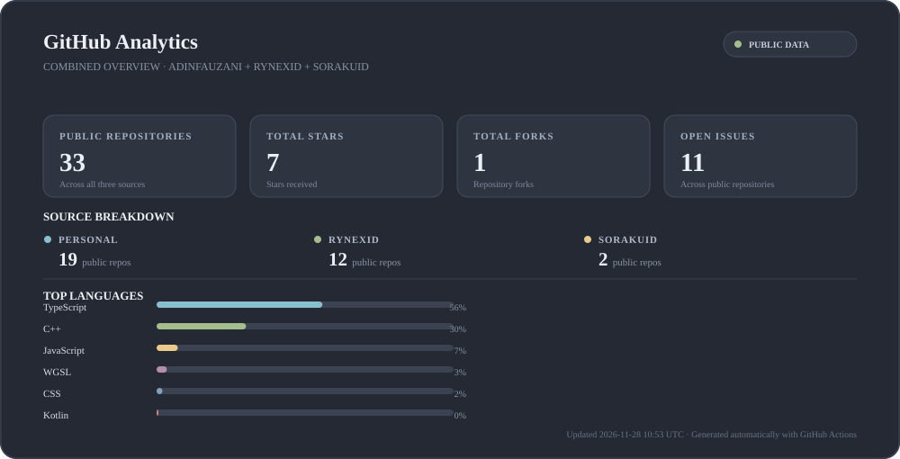

<div align="center">


<p align="center">


</p>

</div>

---

## 🧠 Profile Overview

<div align="left">

```yaml
Name: Adin Fauzan
Alias: Riu
Role: Fullstack Developer

Focus:
  • Web Development
  • Mobile Development
  • Anime Streaming Platform
  • Modern UI/UX
  • Backend Architecture
  • Digital Media Ecosystem
```

<p align="center">
  
  
</p>

<p align="center">
  <picture>
  <source media="(prefers-color-scheme: dark)" srcset="https://spotify-recently-played.jeffreyca.workers.dev/svg?user=31mkyzow45mnwk4a33vsb2m4rg7i&amp;theme=dark" />
  <source media="(prefers-color-scheme: light)" srcset="https://spotify-recently-played.jeffreyca.workers.dev/svg?user=31mkyzow45mnwk4a33vsb2m4rg7i&amp;theme=light" />
  
</picture>
</p>

## ⚡ My Tech

<div align="center">


</div>

<br>

## 📊 GitHub Analytics

<p align="center">
  
</p>

### 🌐 CONNECT WITH ME

<div align="center">

<a href="https://github.com/Adinfauzani">

</a>

<a href="https://dcd.gg/soraku">

</a>

<a href="https://www.soraku.id">

</a>

<a href="https://www.soraku.live">

</a>

</div>

---

<div align="center">
# ⚡ CODE THE FUTURE

### 「 Build • Innovate • Dominate 」


</div>

<div align="center">

</div>
